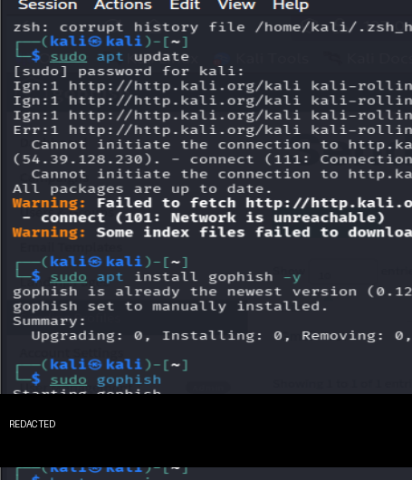
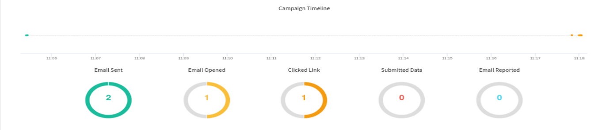

# Experiment 10: Phishing Awareness Simulation

## Purpose

This entry records the aggregate outcome of an authorized phishing-awareness exercise conducted with a controlled test audience. It is an awareness summary, not a guide for configuring or sending phishing campaigns.

## Safety

Use simulations only with explicit authorization and consenting test recipients. Do not collect real passwords or publish recipient details, email content, sending credentials, or campaign configuration. The included screenshots are cropped or redacted to omit personal information and credential material.

## Evidence

The campaign dashboard showed the following counts at the time of capture:

- 2 emails sent
- 1 email opened
- 1 link clicked
- 0 data submissions
- 0 reports

The figures are a point-in-time observation from a controlled test and should not be generalized to other audiences or mail systems.

## Conclusion

The exercise recorded aggregate engagement without documenting recipient-level activity or collecting credentials. Keep future awareness exercises consent-based, minimize collected data, and remove test data when it is no longer needed.

## Source

This sanitized summary is based on the authorized lab experiment in the [source repository](https://github.com/NikhilAngral05/Offensive-Defensive-Security-Lab/tree/main/Exp-10). Screenshots containing campaign setup, recipient details, or credential-capture settings are intentionally not included.
