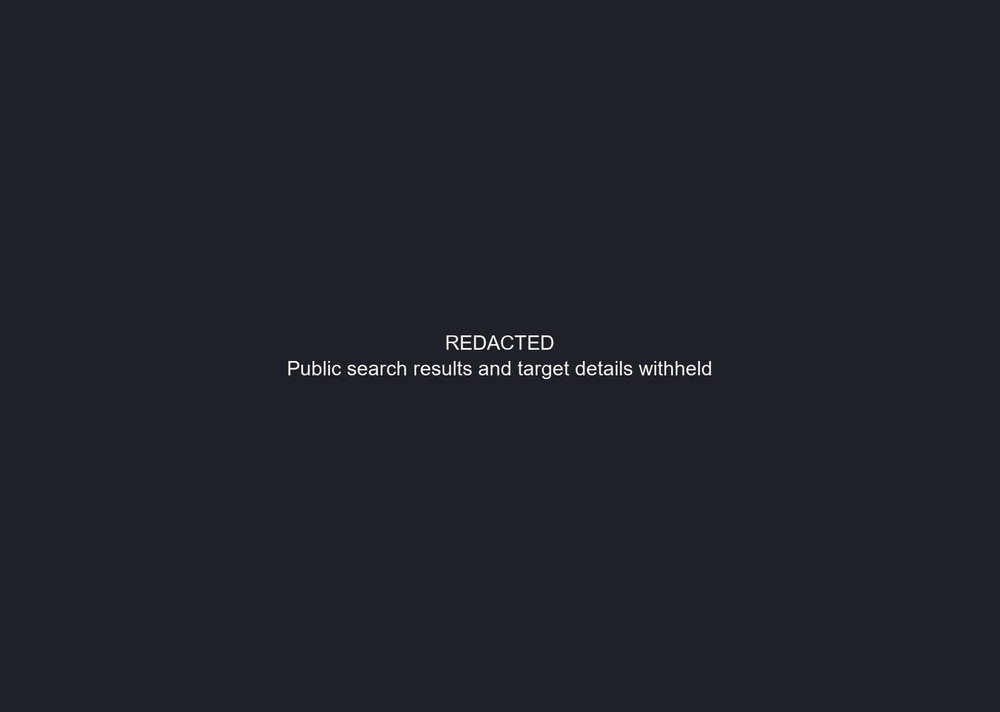
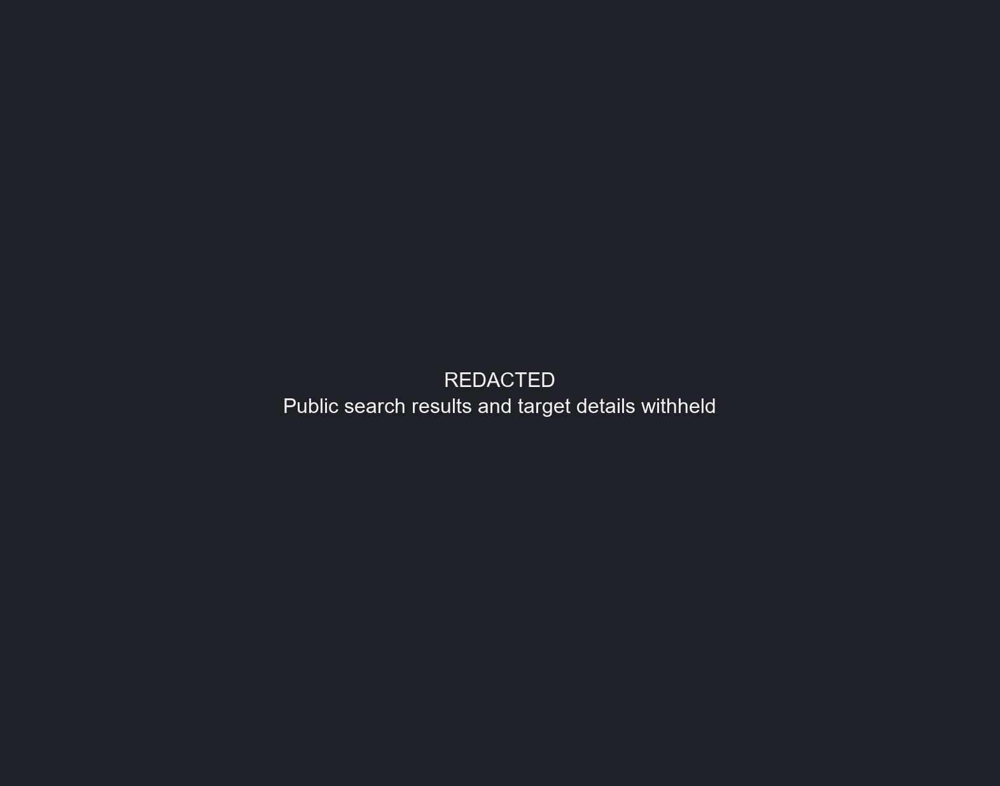
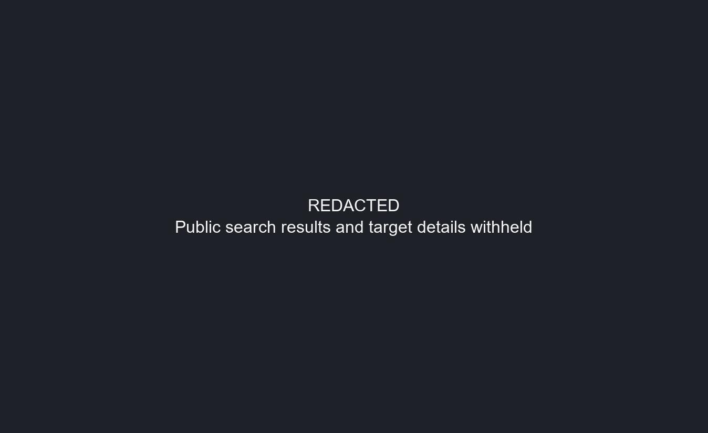
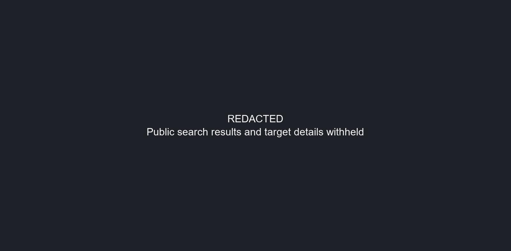
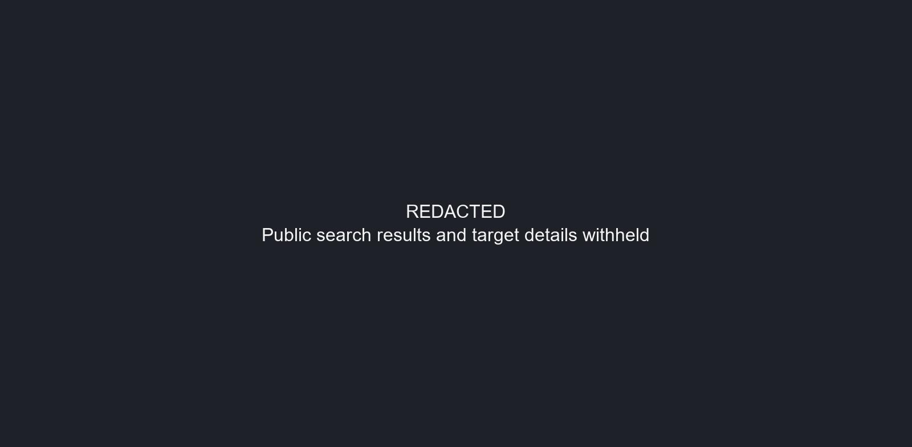

# Experiment 7: Authorized OSINT Review

## Objective

Review how publicly indexed information and internet-facing asset directories can affect an organization's exposure, using only an instructor-provided sample or assets explicitly authorized for assessment.

## Scope and safety

Do not search for, enumerate, or retain information about real organizations or systems without explicit authorization. This public copy omits live search terms, third-party results, and host details. The screenshots are redacted for the same reason.

## Procedure

1. Use a static sample or a domain and asset inventory approved for the exercise.
2. Review how search-engine indexing can reveal information that an asset owner did not intend to publish.
3. Review the applicable search and asset-inventory tools using documentation or instructor-provided examples only.
4. Record potential exposure at a high level. Do not publish hostnames, addresses, banners, login pages, or collected records.

## Result

The exercise reviewed how publicly available information can support asset discovery and why organizations should periodically review their own indexed content and internet-facing services. No third-party systems or findings are identified in this report.

## Screenshots

Search queries, results, and target details have been redacted from each screenshot.

- 
- 
- 
- 
- 
- 
- 
- 
