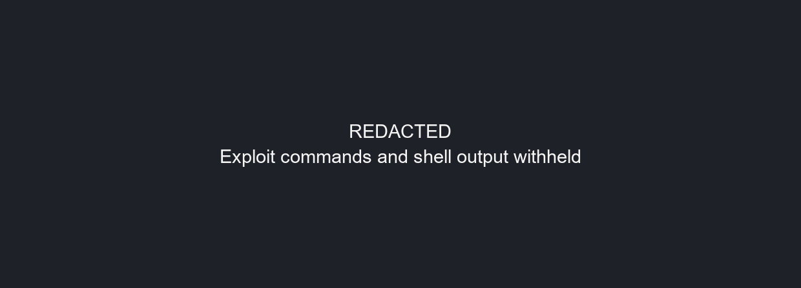
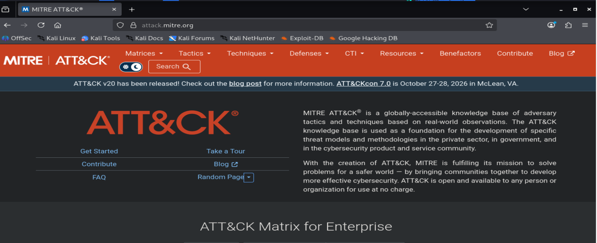
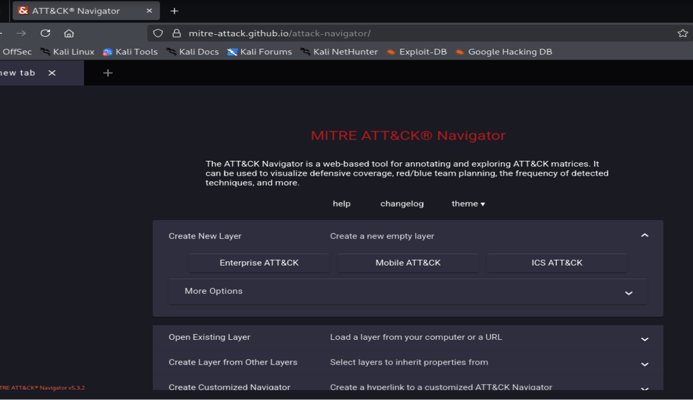
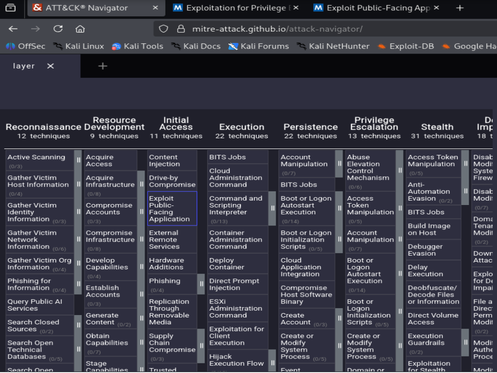
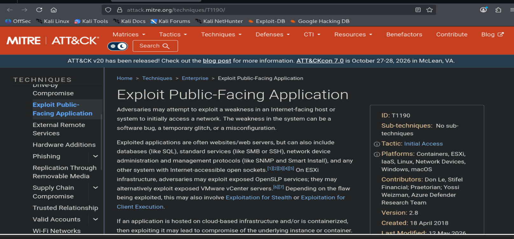

# Experiment 8: MITRE ATT&CK Mapping

## Aim

Review the MITRE ATT&CK Enterprise framework as a way to describe observed behavior in an authorized security lab.

## Requirements and scope

- A web browser with access to MITRE ATT&CK and ATT&CK Navigator
- An authorized, isolated lab for any practical activity

This public copy omits exploit commands and raw shell output. The practical-result screenshot is redacted; the remaining screenshots document framework review only.

## Theory

MITRE ATT&CK is a knowledge base for describing adversary behavior. A tactic represents an objective, while a technique describes a method that may be used to achieve it. ATT&CK Navigator provides a visual interface for exploring and selecting techniques.

Two technique descriptions were reviewed:

- [T1190: Exploit Public-Facing Application](https://attack.mitre.org/techniques/T1190/) describes exploitation of a weakness in an Internet-facing host or system.
- [T1068: Exploitation for Privilege Escalation](https://attack.mitre.org/techniques/T1068/) describes exploitation of a software vulnerability to gain higher privileges.

## Procedure

1. Conduct any practical activity only in an authorized, isolated lab. Detailed exploit evidence is not included in this public report.

   
2. Review the MITRE ATT&CK Enterprise matrix.

   
3. Open ATT&CK Navigator and locate the Enterprise matrix.

   
4. Select T1190 for review. Selection alone does not confirm a technique match.

   
5. Review the official T1190 description and compare its criteria with available evidence.

   
6. Review the official T1068 description. Treat it as a possible classification only when evidence supports a change from lower to higher privileges.

   

## Result

The Enterprise matrix was reviewed in ATT&CK Navigator, and the official descriptions of T1190 and T1068 were examined. A technique should be reported as a confirmed match only when the available evidence supports its defining criteria.

## Conclusion

ATT&CK Navigator helps organize and communicate a mapping. Conclusions should remain within the authorized lab scope and should not exceed what the evidence demonstrates.
